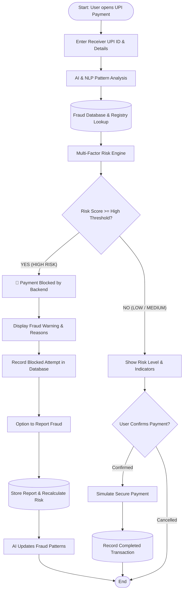

# UPI Fraud Reporting & Pattern Detection Using AI

An AI-powered full-stack web application that identifies suspicious UPI recipients, analyzes fraud descriptions using Natural Language Processing (NLP), assesses multi-factor risk scores, displays warnings, and **strictly blocks high-risk payment attempts** within an interactive simulation environment.

---

## 📌 Architecture & System Flow



---

## 🛠️ Technology Stack

| Layer | Technology | Details |
|---|---|---|
| **Frontend** | HTML5, CSS3, Modern Vanilla JavaScript | Responsive Fintech UI, Real-time Dashboard Polling (5s), Risk Gauges, Evidence Upload, Admin Panel |
| **Backend** | Python 3, Flask, Werkzeug | REST APIs, Server-side Payment Blocking, Session Management, Safe File Uploads |
| **Database** | MySQL 8.0 & SQLite (Dual-Mode) | Parameterized SQL queries, Indexes, Dual-mode support with auto-fallback to SQLite if MySQL credentials are unset |
| **AI & NLP** | scikit-learn, NumPy, Regular Expressions | TF-IDF Vectorization, Multinomial Naive Bayes classifier, Cosine Semantic Similarity, Urgency Pattern Scorer |

---

## 🌟 Key Features

### 1. Payment Risk Checking & Heuristic Evaluation
- Evaluates recipient by UPI ID, display name, phone number, payment note, and optional link.
- Cross-references known complaint records, confirmed fraudster flags, and previous blocked attempts.
- Calculates dynamic risk score (`0 - 100`) and categorizes into:
  - **LOW RISK (0 - 34):** Clean contact, simulated payment proceeds smoothly.
  - **MEDIUM RISK (35 - 69):** Unverified complaints or suspicious handles; requires explicit user acknowledgment.
  - **HIGH RISK (70 - 100):** Verified fraudster match or critical threat indicators; **strictly blocked by backend rules**.

### 2. AI & NLP Fraud Detection
- Detects emerging scam patterns across 7 domain categories:
  1. **Fake KYC Messages** (PAN card expired, SIM block, Remote Access App downloads)
  2. **Fraudulent Payment Requests** (Unauthorized collect requests, fake refund confirmations)
  3. **QR-Code Scams** (Reverse payment fraud, "Scan to receive money" deception)
  4. **Fake Insurance Agents** (Lapsed LIC policy bonus, unclaimed dividend scams)
  5. **Fake Bank Employees** (Credit card limit enhancement, fake nodal officers)
  6. **Fake Customer Care Representatives** (Power cut/electricity bill threats, fake helplines)
  7. **Impersonation and Investment Scams** (Telegram VIP tasks, guaranteed crypto doubling)
- Analyzes linguistic urgency cues and flags Remote Access Tools (`AnyDesk`, `TeamViewer`, `QuickSupport`, `RustDesk`, `.apk`).

### 3. Automatic Updates & Dynamic Recalculation
- Submitting a new fraud report immediately:
  - Stores the report in the database.
  - Recalculates risk score and risk level for the recipient.
  - Dynamically retrains AI vectorizers with new complaint text.
  - Refreshes dashboard statistics without application restart or manual edits.
  - Includes anti-spam safeguards preventing duplicate report flooding.

### 4. Backend-Enforced Payment Blocking
- Blocking rules are strictly enforced in the Flask backend (`/api/payments/pay`).
- Direct backend requests to pay high-risk receivers are rejected with `HTTP 403 (BLOCKED)` and logged in the `blocked_payments` audit ledger.

### 5. Administrative Moderation & Governance
- Role-based admin panel (`admin` / `Admin@123`).
- Review community submissions: Mark as `verified` (elevates receiver risk), `rejected` (reduces receiver risk), or `under_review`.
- Live configurable risk thresholds (Low & High).
- Transaction and blocked payment audit log explorer.

---

## 🚀 Quick Start Guide

### Step 1: Install Dependencies
Open PowerShell or your command prompt in the project directory:
```powershell
pip install -r requirements.txt
```
*(Or `python -m pip install -r requirements.txt`)*

### Step 2: Database Setup

The application features **Dual-Mode Database Architecture**:
- **Automatic SQLite Mode:** Works immediately out-of-the-box without configuring any database credentials (`upi_fraud.db`).
- **MySQL 8.0 Mode:** To connect directly to your local MySQL 8.0 server:
  1. Open `.env` and set your MySQL password:
     ```env
     DB_TYPE=mysql
     DB_HOST=localhost
     DB_PORT=3306
     DB_USER=root
     DB_PASSWORD=your_mysql_password
     DB_NAME=upi_fraud_db
     ```
  2. Or run the interactive setup helper:
     ```powershell
     python setup_mysql.py
     ```

### Step 3: Initialize Database & Seed Synthetic Data
Run the initialization script to create tables and seed realistic test scenarios:
```powershell
python init_db.py
```

### Step 4: Run the Web Application
```powershell
python app.py
```
Open your browser and navigate to:
👉 **`http://localhost:5000`**

---

## 🧪 Testing Scenarios

Click **"Fast Test Scenarios"** on the dashboard or input these test accounts on the **Check Payment Risk** page:

| Scenario | Recipient UPI ID | Details / Description | Expected Result |
|---|---|---|---|
| 🔴 **Fake KYC Scam** | `sbi.kyc.verification@okhdfcbank` | "Urgent KYC fee to prevent freeze download AnyDesk" | **HIGH RISK (96/100) — BLOCKED by Backend** |
| 🔴 **Electricity Disconnection** | `electricity.bill.desk@paytm` | "Power cut notice tonight pay bill immediately" | **HIGH RISK (92/100) — BLOCKED by Backend** |
| 🟡 **Crypto Arbitrage** | `crypto.gainz@okicici` | "Crypto task deposit" | **MEDIUM RISK (52/100) — Warning with Confirmation** |
| 🟢 **Genuine Merchant** | `rahul.sharma@okaxis` | "Dinner split" | **LOW RISK (5/100) — Payment Simulation Allowed** |

---

## 🔬 Automated Test Suite

Run the full end-to-end automated test suite:
```powershell
python test_app.py
```
This tests:
1. AI NLP Pattern Classification & Urgency Detection
2. Multi-factor Risk Scoring across Low, Medium, and High levels
3. Backend Payment-Blocking Server-Side Enforcement (HTTP 403)
4. Successful Simulated Payments (HTTP 200)
5. Fraud Report Submission & Receiver Auto-Recalculation
6. Anti-Spam Duplicate Safeguard (HTTP 409)
7. Dashboard Real-Time Dynamic Statistics
8. Admin Moderation & Receiver Risk Recalculation

---

## 🔐 Default Admin Credentials

- **Username:** `admin`
- **Password:** `Admin@123`
- Accessible via the **Admin Panel** tab on the navigation bar.

---

## 📂 Project Directory Structure

```
upi_fraud_detection/
├── app.py                  # Flask web server & REST API endpoints
├── config.py               # Application configuration & threshold loader
├── database.py             # Universal Database Manager (MySQL + SQLite fallback)
├── schema.sql              # MySQL 8.0 DDL schema script
├── schema_sqlite.sql       # SQLite fallback DDL schema script
├── init_db.py              # Database initialization & synthetic data seeder
├── setup_mysql.py          # Interactive MySQL migration utility
├── ai_detector.py          # AI & NLP text classification & pattern detection
├── risk_engine.py          # Multi-factor risk engine & decision logic
├── test_app.py             # Automated unit and integration test suite
├── requirements.txt        # Python dependency manifest
├── .env.example            # Environment variables template
├── .env                    # Active environment variables
├── README.md               # Documentation & setup instructions
├── uploads/                # Secure directory for evidence attachments
├── templates/
│   └── index.html          # Main single-page web application interface
└── static/
    ├── css/
    │   ├── style.css       # Modern fintech UI styles
    │   └── toast.css       # Toast notification styles
    └── js/
        ├── app.js          # Navigation, real-time polling & dashboard charts
        ├── risk_checker.js # Payment risk evaluation & simulated blocking logic
        ├── report_fraud.js # Fraud reporting with live typing NLP preview
        ├── history_receiver.js # Fraud history registry & receiver risk lookup
        └── admin.js        # Admin login, moderation queue & threshold settings
```
